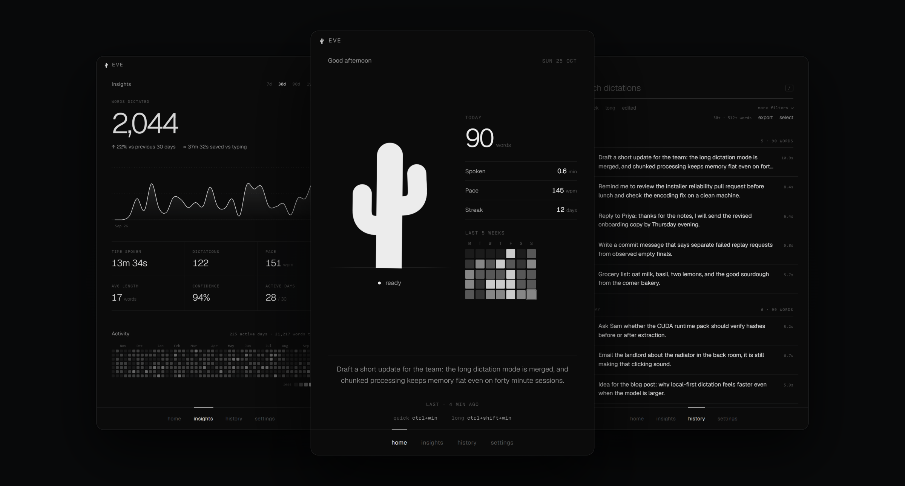
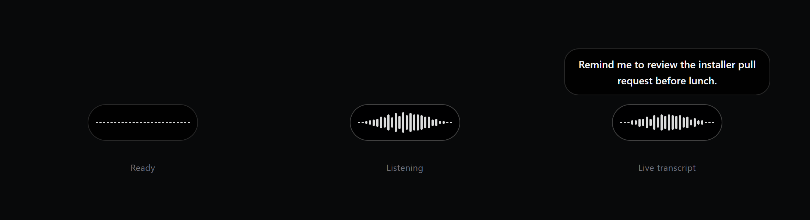
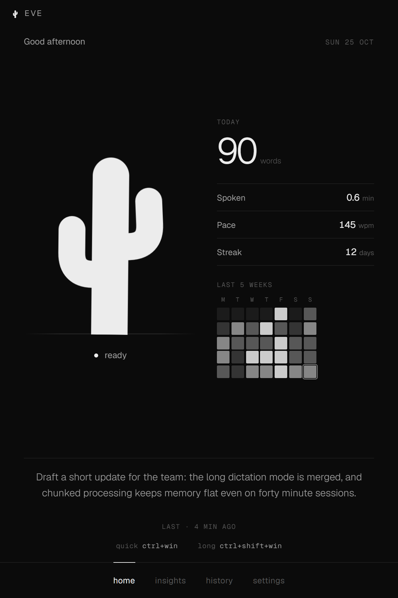
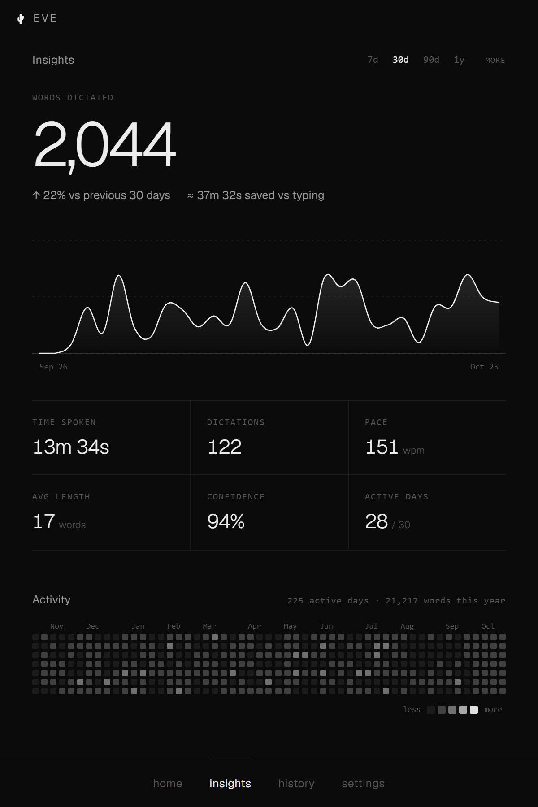
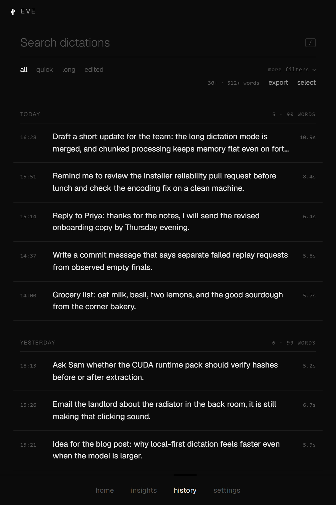
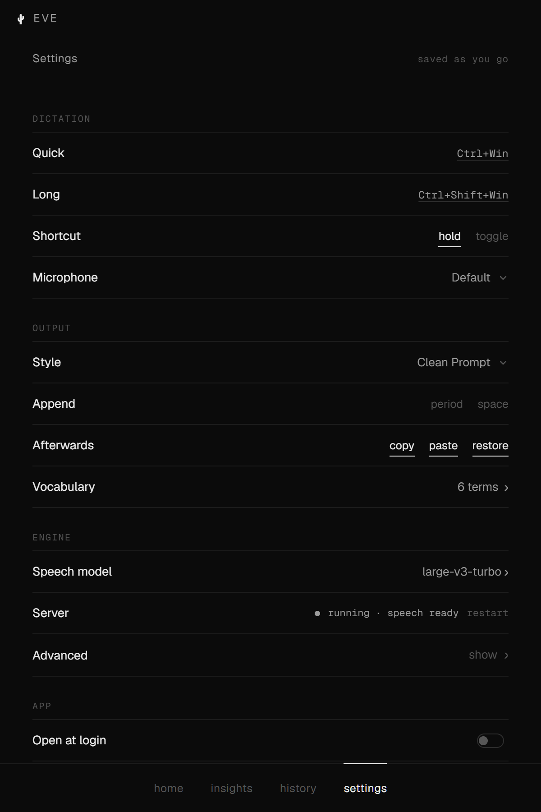

<p align="center">
  
</p>

<h1 align="center">Eve</h1>

<p align="center">
  <strong>Quiet, local dictation for Windows.</strong><br>
  Hold a hotkey, speak, and your words land wherever you were typing.<br>
  Speech recognition runs on your machine.
</p>

<p align="center">
  <a href="https://github.com/burntcookiedough/eve-windows-dictation/releases"></a>
  
  
  <a href="LICENSE"></a>
</p>

<p align="center">
  <a href="https://github.com/burntcookiedough/eve-windows-dictation/releases"><strong>Download</strong></a> ·
  <a href="https://burntcookiedough.github.io/eve-windows-dictation/">Website</a> ·
  <a href="#a-quick-tour">Tour</a> ·
  <a href="#privacy">Privacy</a> ·
  <a href="#build-from-source">Build</a> ·
  <a href="docs/README.md">Docs</a>
</p>

<br>

<p align="center">
  
</p>

<br>

> [!NOTE]
> Eve is in **alpha** (`v0.8.2-alpha.8`). It works day to day, but expect rough edges,
> and read the [release notes](docs/releases/eve-v0.8.2-alpha.8-release-notes.md) before installing.

## Why Eve

Most dictation tools send your voice to a server. Eve runs
[Faster-Whisper](https://github.com/SYSTRAN/faster-whisper) in a small speech service
bundled with the app, so audio never leaves your computer. There is no account and no
telemetry. Your transcripts stay on your machine.

It stays out of the way. A translucent dot appears at the bottom of the screen, opens
into a small timer pill while you talk, and disappears when the text is pasted.

<p align="center">
  
</p>

## A quick tour

<table>
  <tr>
    <td width="50%" valign="top">
      
      <p><strong>Home</strong><br>Today's words, speaking pace, your streak, and the last thing you said, all in one place.</p>
    </td>
    <td width="50%" valign="top">
      
      <p><strong>Insights</strong><br>Words over time, time saved compared with typing, and a year of activity. Calculated locally from your History.</p>
    </td>
  </tr>
  <tr>
    <td width="50%" valign="top">
      
      <p><strong>History</strong><br>Every dictation, searchable and filterable by quick, long, or edited. Copy, delete, or export to JSON or CSV.</p>
    </td>
    <td width="50%" valign="top">
      
      <p><strong>Settings</strong><br>Hotkeys, microphone, output style, vocabulary, and speech model. Changes save as you go.</p>
    </td>
  </tr>
</table>

## What it does

- **Two ways to talk.** Use <kbd>Ctrl</kbd>+<kbd>Win</kbd> for quick notes and
  <kbd>Ctrl</kbd>+<kbd>Shift</kbd>+<kbd>Win</kbd> for long dictation. Hold to talk, or switch to toggle.
- **Long dictation that stays light.** Long recordings are spooled to a temporary file
  and transcribed in chunks, so memory use stays flat. The audio is deleted when the session ends.
- **Text goes where you need it.** Eve copies the text, pastes it into the active window,
  and can then restore your previous clipboard.
- **Output styles.** Paste exactly what you said with Raw Dictation, or let Clean Prompt,
  Codex Prompt, Message Rewrite, or Command Mode tidy it up with local, rule-based cleanup first.
- **Your vocabulary.** Hotwords help Eve spell names, acronyms, and product terms correctly.
- **Pick your model.** Choose `large-v3-turbo` (recommended, about 1.5 GB), `large-v3` for
  maximum accuracy, or `small` for lighter hardware. The current model keeps working while a new one downloads.
- **CPU by default, GPU if you want it.** Eve works out of the box on the CPU. An optional
  NVIDIA CUDA pack, downloaded separately and verified by hash, speeds up transcription on supported GPUs.

## Install

1. Download `Eve.Web.Setup.<version>.exe` from
   [GitHub Releases](https://github.com/burntcookiedough/eve-windows-dictation/releases).
2. Run it. This is a small `nsis-web` installer that downloads the app during setup, so you need
   an internet connection. It is **unsigned**, so Windows SmartScreen may ask you to confirm.
3. Open Eve and hold <kbd>Ctrl</kbd>+<kbd>Win</kbd>. The speech model downloads from Hugging Face the first time you use it.

Checksums (`SHA256SUMS.txt`, `SHA512SUMS.txt`) are published with each release.

## Privacy

- Speech recognition runs in a local service on your machine. Audio and transcripts are never uploaded.
- History and Insights live in a local SQLite database. Long-dictation audio is temporary
  and is never written to History or logs.
- The network is used only to download the installer payload, model weights on first use,
  and the optional GPU pack if you install it.
- Copied diagnostics exclude logs, file paths, History, and transcript text.

Full details are in [PRIVACY.md](PRIVACY.md).

## Build from source

Eve is an Electron + Svelte app (`app/`) with a Python FastAPI/WebSocket speech service (`server/`).
You need Bun, uv, Python 3.11, and PowerShell 7. Run everything from Windows PowerShell, not WSL.

```powershell
Set-Location app
bun install --frozen-lockfile
bun run build

Set-Location ../server
uv sync --extra whisper --group dev --frozen
uv run pytest
```

See [Building Eve on Windows](docs/development/building.md) for running the dev server,
packaging, and release checks, and the [protocol](docs/protocol.md) for how the app talks to the speech service.

## Contributing

Issues and pull requests are welcome. Start with [CONTRIBUTING.md](.github/CONTRIBUTING.md),
and please never include real dictated text, audio, or personal paths in reports, fixtures, or screenshots.
For help, see [SUPPORT.md](.github/SUPPORT.md). For security issues, see [SECURITY.md](.github/SECURITY.md).

## Credits

Eve is derived from [Murmur](NOTICE.md), the MIT-licensed project created by Raik Rohde.
Speech recognition is powered by Faster-Whisper and CTranslate2.
Third-party licenses are listed in [THIRD_PARTY_NOTICES.md](THIRD_PARTY_NOTICES.md).

Released under the [MIT License](LICENSE).

<p align="center"><sub>The screenshots use demo data, not real dictations.</sub></p>
